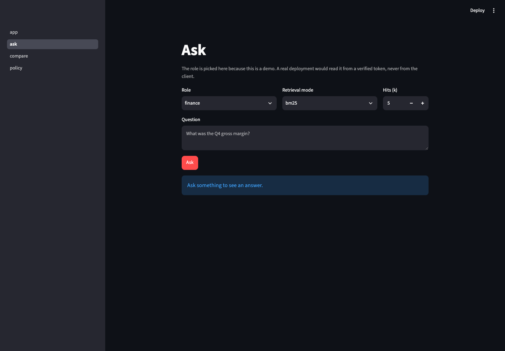
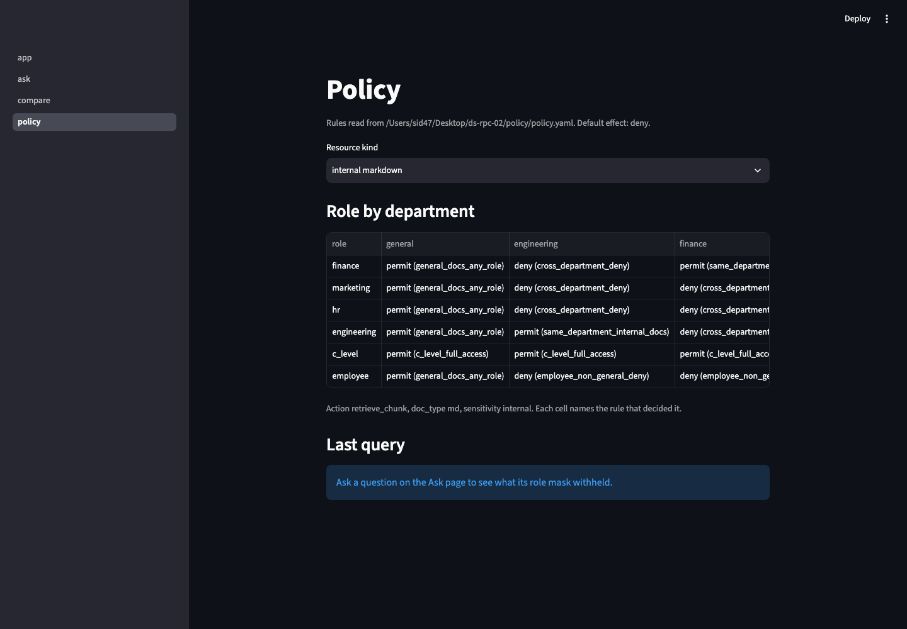
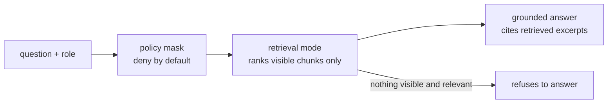

# finrag

A chatbot for FinSolve, a fictional fintech firm, where every employee sees only
what their role allows. Ask a question as marketing and you get marketing's
documents; ask the same question as HR and you get HR's. The access rule is not
a prompt asking the model to behave. It runs before ranking, inside the
retrieval layer, and an automated sweep proves it: 50 questions times 6 roles
times 7 retrieval modes, 2,100 checks, zero leaks.

The project answers a business question with measurements instead of claims:
which retrieval strategies earn their cost? Seven modes compete on the same
50-question test set, from plain keyword search to a multi-hop agent. Two of
the seven lose, and the tables below say so.

## See it work

Three real API calls, saved in [`evals/results/r6_smoke_20260730T0017.json`](evals/results/r6_smoke_20260730T0017.json).

Marketing asks a marketing question and gets a cited answer:

```json
{"question": "In Q3 2024, which activity produced 500,000 impressions, and how many influencers took part?",
 "role": "marketing", "mode": "hybrid_rerank"}
```
```json
{"answer": "In Q3 2024, influencer marketing produced 500,000 impressions, and 25 regional influencers took part [1].",
 "citations": ["marketing/marketing_report_q3_2024#campaign-highlights--latin-american-expansion"],
 "audit": {"visible_to_role": 106, "masked_out": 212}}
```

Marketing asks for an employee's salary and gets nothing, because HR rows never
reach its retriever:

```json
{"question": "What is Aadhya Patel's salary?", "role": "marketing", "mode": "bm25"}
```
```json
{"answer": null, "reason": "no_answer",
 "audit": {"visible_to_role": 106, "masked_out": 212}}
```

HR asks about the same employee and gets an answer with a citation, because the
mask is per role, not per topic:

```json
{"question": "Which department and city does Aadhya Patel work in?", "role": "hr", "mode": "bm25"}
```
```json
{"answer": "Aadhya Patel works in the Sales department in Ahmedabad [1].",
 "citations": ["hr/hr_data#row-FINEMP1000"]}
```

Even for HR, the salary itself stays out of reach: it lives in a payload field
that retrieval never returns, gated behind a separate `view_row` action.

The same calls, in the UI:



The policy page renders the role by department matrix by asking the policy
engine per cell, so the screen can never drift from the rules. Each cell names
the rule that decided it:



## Seven modes, rising agency

The modes form a ladder. Each step gives the system more say in what happens,
and each step is measured against the ones below it.

| step | mode | what decides the ranking |
|---|---|---|
| fixed pipeline | `naive` | word overlap |
| fixed pipeline | `bm25` | BM25 over a saved index |
| fixed pipeline | `dense` | cosine over Vertex text embeddings |
| fixed pipeline | `hybrid` | Reciprocal Rank Fusion of bm25 + dense |
| one model call | `hybrid_rerank` | Gemini reorders hybrid's top 20, once per query |
| knowledge graph | `graphrag` | a two-hop walk in Neo4j, mask inside the Cypher |
| agent loop | `react` | the model writes its own searches, up to 4 hops, then its own cited answer |

Can you run them? Every mode runs without credentials; three degrade:

| mode | needs | without credentials |
|---|---|---|
| naive, bm25 | nothing | full behavior, offline |
| dense, hybrid | Vertex embeddings, built once and cached | runs on deterministic fake vectors; rankings become stand-ins |
| hybrid_rerank | Vertex | runs; falls back to plain hybrid order and counts every fallback |
| graphrag | Docker (Neo4j), no cloud account | full structural behavior; the LLM entity layer is optional |
| react | Vertex | runs safely but loses its agency: one fallback search, no hops |

More agency never widens access. The agent's only tool is a retriever that
masks before it ranks, so agency changes what gets asked, never what can be
seen. The role string never appears in any prompt the agent reads.

## Results

Section hit rate and section MRR at k=10, 50 gold questions, leakage always 0.
Every cell comes from a JSON file in [`evals/results/`](evals/results/).

| mode | section hit | section MRR |
|---|---|---|
| naive | 0.725 | 0.488 |
| bm25 | 0.750 | 0.637 |
| dense | 0.900 | 0.780 |
| hybrid | 0.925 | 0.663 |
| hybrid_rerank | 0.950 | 0.804 |
| graphrag | 0.450 | 0.168 |
| react | **0.975** | **0.896** |

Per tier (section hit / section MRR):

| tier | n | naive | bm25 | dense | hybrid | hybrid_rerank | graphrag | react |
|---|---|---|---|---|---|---|---|---|
| T1 direct | 8 | 1.00 / .74 | 1.00 / .79 | .88 / .81 | 1.00 / .83 | 1.00 / .90 | .63 / .30 | 1.00 / .94 |
| T2 paraphrase | 8 | .13 / .02 | .00 / .00 | .88 / .73 | .63 / .20 | .88 / .81 | .13 / .13 | 1.00 / 1.00 |
| T3 temporal | 10 | .80 / .63 | .80 / .70 | .90 / .65 | 1.00 / .72 | .90 / .66 | .10 / .02 | 1.00 / .87 |
| T4 multi-hop | 10 | 1.00 / .78 | 1.00 / .92 | .83 / .83 | 1.00 / .74 | 1.00 / .88 | .50 / .08 | .83 / .75 |
| T5 aggregation | 6 | .67 / .35 | 1.00 / .77 | 1.00 / .89 | 1.00 / .78 | 1.00 / .77 | 1.00 / .41 | 1.00 / .86 |
| T6 access probes | 8 | 1.00 / .23 | 1.00 / 1.0 | 1.00 / 1.0 | 1.00 / 1.0 | 1.00 / 1.0 | 1.00 / .12 | 1.00 / 1.0 |

Four findings the tables force:

- **Dense embeddings earn their keep.** They exist to catch questions that share
  no words with the answer, and tier T2 went from 0.000 to 0.875 section hit.
- **Fusion alone loses.** Hybrid RRF drops 0.117 section MRR against dense by
  itself, because rank fusion punishes one list's strong, correct opinion. Only
  the fusion plus rerank pair beats dense.
- **Graph RAG lost, and the mechanism is known.** Department nodes connect to
  every chunk their department owns, so ranking by graph paths measures
  department size, not relevance. The build log records the fix to try next.
- **The agent ranks best and answers worst.** `react` tops five of six tiers,
  but in a head-to-head on the ten multi-hop questions it wins 1 and loses 3
  against `hybrid_rerank`, and it costs 2.6 model calls per question. So route
  by job: `react` when the ranked list is the product, `hybrid_rerank` when the
  answer is.

## How it works



Every chunk carries stamps from ingest: owner department, document type,
sensitivity. A YAML policy decides per role and action, deny by default. Every
retriever computes the role's visible set first and ranks only inside it, so a
denied chunk never holds a rank slot, never reaches a rerank prompt, and never
feeds an agent's reasoning. Generation answers only from the retrieved
excerpts, cites them by number, and refuses when the context lacks the answer.

Each retriever checks the mask at least twice: once before scoring, once as the
hits leave. The eval harness then re-checks every returned hit against the
policy rules from scratch, trusting no stamp. Three locks on the same door,
each tested by deliberately breaking the others.

## The test set

Fifty questions in six tiers, each written against a known place in the corpus
([`evals/gold/gold_set.json`](evals/gold/gold_set.json)):

| tier | tests | example |
|---|---|---|
| T1 direct | word match | "What are the RTO and RPO in the disaster recovery plan?" |
| T2 paraphrase | zero word overlap | "By how much did buyer attrition shrink during the festive stretch?" (the corpus says "churn", never "attrition") |
| T3 temporal | right quarter among four | "In Q3 2024, which activity produced 500,000 impressions?" |
| T4 multi-hop | two documents, one answer | "Finance put 35 percent of $130M of vendor services behind loyalty. What did the loyalty programme return?" |
| T5 aggregation | computed facts | "Which department has the highest average salary?" |
| T6 access probes | refusal, not retrieval | "What is Aadhya Patel's salary?" asked as marketing |

Two scoring choices worth knowing:

- **Section rank is the headline, not document recall.** After the mask, a role
  may see as few as 26 chunks, so finding the right document is nearly free.
  Finding the right section of it is the real test, and that is what the tables
  score.
- **The leakage sweep asks every question in every role.** The gold set alone
  never asks anything as `employee`, so a retriever leaking only to `employee`
  would score a clean zero. The sweep closes that hole: all questions, all six
  roles, all seven modes, every returned chunk re-judged by the policy engine.

## Download and run

Needs Python 3.12 and [uv](https://docs.astral.sh/uv/). Optional: Docker for
the graph mode, a Google Cloud project with Vertex AI for embeddings and real
answers.

```bash
git clone <this repo> && cd ds-rpc-02
uv sync --group dev --group ui
uv run pytest              # 658 tests, offline, no credentials, ~3 seconds
```

Full offline demo, no accounts of any kind:

```bash
export FINRAG_EMBEDDER=fake FINRAG_LLM=fake
uv run finrag ingest       # corpus -> chunks, bm25 index, stand-in vectors
uv run finrag eval --mode bm25   # score a mode against the gold set
uv run finrag sweep        # the leakage gate; must print 0 violations
uv run finrag serve        # API on http://127.0.0.1:8000, docs at /docs
uv run finrag ui           # Streamlit pages, needs the API running
```

With a Vertex project, put two lines in `.env` and drop the fake flags:

```bash
VERTEX_PROJECT=your-project-id
VERTEX_LOCATION=us-central1
```

That unlocks real embeddings (`dense`, `hybrid`), the reranker, the `react`
agent, and generated answers with citations. Embeddings are cached by content
hash, so a repeated ingest or eval makes zero API calls.

For `graphrag`, start the local graph and build it:

```bash
docker run -d --name finrag-neo4j -p 7474:7474 -p 7687:7687 \
  -e NEO4J_AUTH=neo4j/finragdev neo4j:5-community
uv run finrag graph        # structural graph, no cloud calls
uv run finrag graph --llm  # optional entity layer via Gemini
```

With the container down, graph tests skip with a printed reason and the sweep
drops the mode and says so.

Troubleshooting on macOS: if `finrag` is reported missing right after a sync,
run `chflags nohidden .venv/lib/python3.12/site-packages/*.pth` and retry. Some
uv versions mark those files hidden and Python then skips them.

## Repo map

| path | what it holds |
|---|---|
| `src/finrag/ingest/` | corpus to chunks, with ownership stamps and HR PII split into a gated payload |
| `src/finrag/policy/` | the policy engine; rules live in `policy/policy.yaml` |
| `src/finrag/retrieval/` | the seven modes and the shared mask helpers |
| `src/finrag/graph/` | Neo4j schema, builders, and the masked traversal |
| `src/finrag/react*.py` | the agent loop, its prompt, and its retriever |
| `src/finrag/generate.py`, `api/`, `ui/` | grounded answers, FastAPI, Streamlit |
| `src/finrag/eval/` | metrics, harness, gold-set validation, the leakage sweep |
| `evals/gold/` | the 50-question test set |
| `evals/results/` | one JSON per eval run; every number above lives here |
| `DECISIONS.md` | the build log: eight dated stages, each with its eval table and an independent review before commit |
| `docs/` | [data](docs/data.md), [walkthrough](docs/walkthrough.md), open items |

## Read more

- [`docs/data.md`](docs/data.md): the corpus, the chunks, the planted
  contradictions, and the gold set.
- [`docs/walkthrough.md`](docs/walkthrough.md): one chunk, one policy decision,
  one agent run traced end to end, including a failure.
- [`DECISIONS.md`](DECISIONS.md): why each piece exists, what it cost, what it
  broke, and the numbers before and after. Start there to judge the process
  rather than the result.

Stack: Python 3.12, bm25s, Vertex AI (google-genai, text-embedding-005 and
Gemini 2.5 Flash), Neo4j 5, FastAPI, Streamlit, uv, pytest.
