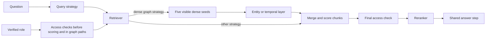

# FinRAG

> When does more agency improve RAG, and when does it only add cost and new
> ways to fail?

I built FinRAG to test that question. Retrieval-augmented generation (RAG)
finds source text before a model answers. I split that work into query
planning, retrieval, and reranking so I can change one choice at a time.

This matters to a recruiter because the project is evidence of how I structure
an AI system. I set clear contracts, limit model control, test the parts, and
report results that disagree with my design. The sample company data is only a
test bed.

## What I built

FinRAG has three query choices, seven retrievers, two rerankers, and one shared
answer step. It tests them on 50 questions about direct facts, paraphrases,
quarters, joined evidence, conflicts, and access rules.

GraphRAG means using graph structure to help choose evidence. I made three
graph retrievers so the graph itself is a testable choice:

- `graph_keyword` enters through words and ranks by graph path count;
- `graph_entity` enters through five dense-search seeds, then follows only
  entity and claim links; and
- `graph_temporal` uses the same seeds and score, but follows only quarter and
  metric links.

The API, command line, web app, and evaluation code all discover these choices
from one strategy catalog. A run name states the full choice. For example,
`direct__graph_entity__none` uses the original question, the entity graph, and
no reranker.

The [architecture map](docs/architecture.md#how-the-design-maps-to-questions)
connects each question type to the choices designed to help it. The
[evidence map](docs/experiments.md#strategy-to-question-evidence-map) then
shows which ideas worked, failed, or still need a controlled test.

## How the three RAG parts fit together



| Part | Choices | Job |
|---|---|---|
| Query | `direct`, `hyde`, `react` | Decide what searches to make |
| Retrieval | `naive`, `bm25`, `dense`, `hybrid`, `graph_keyword`, `graph_entity`, `graph_temporal` | Rank allowed source sections |
| Reranking | `none`, `llm` | Keep or change the order |

HyDE means Hypothetical Document Embeddings. It makes possible answer text for
search only. ReAct means Reason and Act. Here, it may plan four searches and
pick evidence. Neither writes the final answer.

## The choices I made and why

| Choice | Why |
|---|---|
| Split query, retrieval, and reranking | I can change one decision without changing the others |
| Let ReAct search, but not answer | Retrieval skill stays separate from writing skill |
| Keep HyDE text out of evidence | Made-up search text is not a source |
| Make reranking order-only | A reranker may not invent, add, drop, or copy evidence |
| Load services only when needed | BM25 should not need Vertex or Neo4j |
| Check access before scoring and graph walks | Hidden text must not affect rank through a score or path |
| Use the same entry and score for two graph layers | The controlled test changes the graph, not the rest of retrieval |
| Keep the weak keyword graph | A simple baseline shows whether more structure earns its cost |
| Use small contracts instead of LangChain | The source shows which part searched, ranked, or called a service |

For the two semantic graph retrievers, each dense seed gets a direct score of
`1 / seed rank`. A connected chunk gains `1 / (seed rank × (shortest path +
1))` from each distinct seed. The walk is capped at three hops. Ties use chunk
ID. This makes every score traceable.

## What the tests showed

I held the corpus, chunks, roles, query, reranker, embedding model, seed count,
hop limit, and `k` fixed. Dense retrieval is the control. The two semantic
graph rows differ only in the edge layer they may walk.

| Pipeline | Section hit | Section MRR | Section recall@10 | Both conflict sources | Leaks |
|---|---:|---:|---:|---:|---:|
| [`direct__dense__none`](evals/results/graph_compare_direct__dense__none_20260901T2221.json) | 0.900 | 0.780 | 0.883 | 2/4 | 0 |
| [`direct__graph_keyword__none`](evals/results/graph_compare_direct__graph_keyword__none_20260901T2221.json) | 0.425 | 0.163 | 0.354 | 1/4 | 0 |
| [`direct__graph_entity__none`](evals/results/graph_compare_direct__graph_entity__none_20260901T2221.json) | 0.975 | 0.792 | 0.927 | 3/4 | 0 |
| [`direct__graph_temporal__none`](evals/results/graph_compare_direct__graph_temporal__none_20260901T2221.json) | 0.875 | 0.770 | 0.796 | 3/4 | 0 |

The entity graph improved overall coverage. On T2-04, dense search missed the
right section in its first ten results. Entity links brought it back at rank 8.
That is a retrieval win, but not a strong rank.

The temporal graph failed to specialise. On the ten time questions, its
section hit rate was 0.700; dense scored 0.900. On T3-04, dense put the right Q3
section at rank 2. The temporal graph missed it and filled the first ten places
with Q1 and Q2 sections. The correct section was one of the five seeds, but
broad quarter links pushed it out of the final ten.

The keyword graph stayed weak. Exact word entry missed paraphrases, while raw
path count rewarded broad hubs. I would fix the temporal schema before adding
more graph methods.

The full access sweep checked 42 pipelines across six roles: 12,600 cells and
117,798 returned hits. It found zero policy violations.

The separate agent runs also matter. ReAct rescued a paraphrase on T2-04, but
on T4-03 it spent four similar searches and returned no evidence. These runs
change different parts, so I treat them as case studies, not a causal graph
comparison. [The walkthrough shows both sets of traces](docs/walkthrough.md).

The old [`r5_graphrag`](evals/results/r5_graphrag_20260730T0012.json) file keeps
its original name. It is an older run and is not comparable with this matrix.

## One quick experiment

This offline path needs Python 3.12 and
[`uv`](https://docs.astral.sh/uv/). Fake services prove the flow, not retrieval
quality.

```bash
uv sync --group dev --group ui
FINRAG_EMBEDDER=fake FINRAG_LLM=fake uv run finrag ingest
FINRAG_EMBEDDER=fake FINRAG_LLM=fake uv run finrag eval \
  --query-strategy direct --retriever bm25 --reranker none --rung local
```

See [Running FinRAG](docs/running.md) for Vertex, Neo4j, graph building, the
API, the web app, and the full comparison.

## Known limits

- The corpus is small and built for this project.
- Entity extraction used 318 model calls on the first build. The local cache
  made the repeated build use zero calls.
- Entity names use simple lower-case and space rules. They do not resolve
  aliases or pronouns.
- Quarter and metric links are broad. The results show that they can push the
  right seed out of the final list.
- The demo lets the client choose a role. A real service must use a verified
  identity.

## Where to read more

- [Architecture](docs/architecture.md): question map, graph shapes, flow, contracts, and framework boundary
- [Experiments](docs/experiments.md): evidence map, coverage, metrics, results, costs, and limits
- [Walkthrough](docs/walkthrough.md): one success and one failure for agents and graphs
- [Security](docs/security.md): access checks before scores, paths, and prompts
- [Data](docs/data.md): the test bed, conflicts, roles, and graph inputs
- [Running FinRAG](docs/running.md): setup, services, commands, API, and UI
